<a href="https://portfolio-alex-m-kamau.vercel.app">
<picture>
  <source media="(prefers-color-scheme: dark)" srcset="assets/hero-dark.svg" />
  <source media="(prefers-color-scheme: light)" srcset="assets/hero-light.svg" />
  
</picture>
</a>

&nbsp;&nbsp;&nbsp;&nbsp;&nbsp;&nbsp;&nbsp;&nbsp;

 

I design, build and **operate** business-critical web platforms, from the first requirements conversation to the production server and everything after it ships.

I'm the full-stack developer and sole technical owner for **four companies**, and I build my own products and open-source software on the side. I pick the stack to fit the problem: **React** and **Next.js** on the front, **Laravel**, **Node.js** or **FastAPI** behind it, on **PostgreSQL** or **MySQL**, run on **Linux** and **Docker**.

<b>4</b> companies I run tech for &nbsp;·&nbsp; <b>3</b> platforms in production &nbsp;·&nbsp; Mozilla RCC <b>Top 5</b> &nbsp;·&nbsp; open-source maintainer

## Platforms I run for businesses

<a href="https://www.euroafriquecorporateskills.com"><picture><source media="(prefers-color-scheme: dark)" srcset="assets/card-euroafrique-dark.svg" /><source media="(prefers-color-scheme: light)" srcset="assets/card-euroafrique-light.svg" /></picture></a>&nbsp;<a href="https://afriasiacareercenter.com"><picture><source media="(prefers-color-scheme: dark)" srcset="assets/card-afriasia-dark.svg" /><source media="(prefers-color-scheme: light)" srcset="assets/card-afriasia-light.svg" /></picture></a>

<a href="https://chaniapublishers.com"><picture><source media="(prefers-color-scheme: dark)" srcset="assets/card-chania-dark.svg" /><source media="(prefers-color-scheme: light)" srcset="assets/card-chania-light.svg" /></picture></a>&nbsp;<a href="https://portfolio-alex-m-kamau.vercel.app/work/chania-finance-consultancy"><picture><source media="(prefers-color-scheme: dark)" srcset="assets/card-chania-finance-dark.svg" /><source media="(prefers-color-scheme: light)" srcset="assets/card-chania-finance-light.svg" /></picture></a>

## Products and open source

<a href="https://portfolio-alex-m-kamau.vercel.app/work/businessos"><picture><source media="(prefers-color-scheme: dark)" srcset="assets/card-businessos-dark.svg" /><source media="(prefers-color-scheme: light)" srcset="assets/card-businessos-light.svg" /></picture></a>&nbsp;<a href="https://portfolio-alex-m-kamau.vercel.app/work/unified-threat-detection-response"><picture><source media="(prefers-color-scheme: dark)" srcset="assets/card-utdrs-dark.svg" /><source media="(prefers-color-scheme: light)" srcset="assets/card-utdrs-light.svg" /></picture></a>

<a href="https://portfolio-alex-m-kamau.vercel.app/work/secure-file-sharing"><picture><source media="(prefers-color-scheme: dark)" srcset="assets/card-secure-file-sharing-dark.svg" /><source media="(prefers-color-scheme: light)" srcset="assets/card-secure-file-sharing-light.svg" /></picture></a>&nbsp;<a href="https://github.com/Alex-Muhscience/MuhOS"><picture><source media="(prefers-color-scheme: dark)" srcset="assets/card-muhos-dark.svg" /><source media="(prefers-color-scheme: light)" srcset="assets/card-muhos-light.svg" /></picture></a>

Also built: <a href="https://muhscience-tech-labs-website.vercel.app"><b>Muhscience Tech Labs</b></a>, a Next.js company site, and <a href="https://github.com/Alex-Muhscience/Pass-KeyGen"><b>KeyGen</b></a>, a Flutter password manager. Every project has a full case study on my <a href="https://portfolio-alex-m-kamau.vercel.app/work">portfolio</a>.

<b>How I put a platform together</b>

 

Not one system, but the shape most of mine share: a boring, fast request path, with everything slow or failure-prone pushed behind it.

<picture>
  <source media="(prefers-color-scheme: dark)" srcset="assets/architecture-dark.svg" />
  <source media="(prefers-color-scheme: light)" srcset="assets/architecture-light.svg" />
  
</picture>

- **Architecture follows requirements.** A content site, a payment workflow and a multi-tenant ledger don't want the same design.
- **Modular monolith first.** Services get extracted when a domain proves it needs to scale or release on its own.
- **Contain failure.** A slow PDF render or a dead webhook should never fail an unrelated checkout.
- **Security and audit are architecture,** designed in from the first schema.
- **Measure, then optimise.** Find the bottleneck with real data volume, then fix that one thing.
- **Build systems that can be operated.** Health checks, correlated logs, repeatable deploys and tested restores are part of the feature.

## Toolbox

**Languages & frameworks** 

**Data & infrastructure** 

Also: Livewire · Alpine.js · Playwright · k6 · JWT · TOTP MFA · RBAC · Row-level security · M-Pesa · Paystack · Algolia · QML / Qt · Hyprland · RPM packaging · systemd

## Journey

<picture>
  <source media="(prefers-color-scheme: dark)" srcset="assets/journey-dark.svg" />
  <source media="(prefers-color-scheme: light)" srcset="assets/journey-light.svg" />
  
</picture>

## Activity

<picture>
  <source media="(prefers-color-scheme: dark)" srcset="https://raw.githubusercontent.com/Alex-Muhscience/Alex-Muhscience/output/github-streak.svg" />
  <source media="(prefers-color-scheme: light)" srcset="https://raw.githubusercontent.com/Alex-Muhscience/Alex-Muhscience/output/github-streak-light.svg" />
  
</picture>

<picture>
  <source media="(prefers-color-scheme: dark)" srcset="https://raw.githubusercontent.com/Alex-Muhscience/Alex-Muhscience/output/github-contribution-grid-snake-dark.svg" />
  <source media="(prefers-color-scheme: light)" srcset="https://raw.githubusercontent.com/Alex-Muhscience/Alex-Muhscience/output/github-contribution-grid-snake.svg" />
  
</picture>

 

<a href="mailto:alex.kamau.2558@gmail.com">
<picture>
  <source media="(prefers-color-scheme: dark)" srcset="assets/footer-dark.svg" />
  <source media="(prefers-color-scheme: light)" srcset="assets/footer-light.svg" />
  
</picture>
</a>

Every graphic on this page is generated by <a href="scripts/build_assets.py"><code>scripts/build_assets.py</code></a>.

