

<a href="https://portfolio-alex-m-kamau.vercel.app">
<picture>
  <source media="(prefers-color-scheme: dark)" srcset="assets/hero-dark.svg" />
  <source media="(prefers-color-scheme: light)" srcset="assets/hero-light.svg" />
  
</picture>
</a>

&nbsp;&nbsp;&nbsp;&nbsp;&nbsp;&nbsp;&nbsp;&nbsp;

 

I design, build and **operate** business-critical web platforms from the first requirements conversation to the production server, and everything after it ships.

Today I'm the full-stack developer and sole technical owner for three companies: **EuroAfrique Corporate Skills**, **Chania Publishers** and **AfriAsia Career Development Center**. Each runs on a platform I architected, built, deployed and keep running. On the side, I'm building **BusinessOS**, a multi-tenant business operating system, and a **secure file sharing platform** for teams, and I maintain **[MuhOS](https://github.com/Alex-Muhscience/MuhOS)**, an open-source desktop shell for Hyprland on Fedora. I was a **Top 5 finalist** in the Mozilla Responsible Computing Challenge.

I pick the stack to fit the problem: **React** and **Next.js** on the front, **Node.js**, **Laravel**, **FastAPI** or **Flask** behind it, and **TypeScript**, **Python** and **PHP** as the working languages.

## How I put a platform together

Not one system, but the shape most of mine share: a boring, fast request path, with everything slow or failure-prone pushed behind it.

<picture>
  <source media="(prefers-color-scheme: dark)" srcset="assets/architecture-dark.svg" />
  <source media="(prefers-color-scheme: light)" srcset="assets/architecture-light.svg" />
  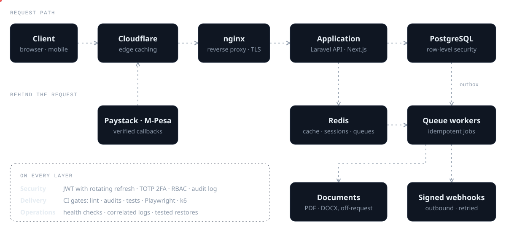
</picture>

**The rules behind it**

- **Architecture follows requirements.** A content site, a payment workflow and a multi-tenant ledger don't want the same design.
- **Modular monolith first.** Services get extracted when a domain proves it needs to scale or release on its own.
- **Contain failure.** A slow PDF render or a dead webhook should never fail an unrelated checkout.
- **Security and audit are architecture,** designed in from the first schema — not bolted on later.
- **Measure, then optimise.** Find the bottleneck with real data volume, then fix that one thing.
- **Build systems that can be operated.** Health checks, correlated logs, repeatable deploys and tested restores are part of the feature.

## Featured work

Each card traces what the system does, left to right. Click one to open it.

<a href="https://portfolio-alex-m-kamau.vercel.app/work/businessos">
<picture>
  <source media="(prefers-color-scheme: dark)" srcset="assets/project-businessos-dark.svg" />
  <source media="(prefers-color-scheme: light)" srcset="assets/project-businessos-light.svg" />
  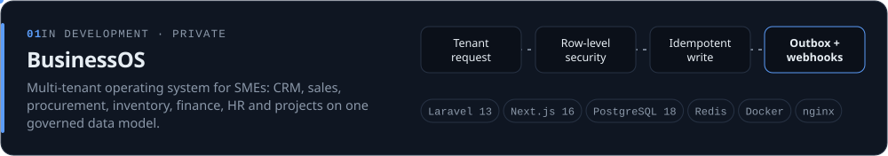
</picture>
</a>

<a href="https://portfolio-alex-m-kamau.vercel.app/work/unified-threat-detection-response">
<picture>
  <source media="(prefers-color-scheme: dark)" srcset="assets/project-utdrs-dark.svg" />
  <source media="(prefers-color-scheme: light)" srcset="assets/project-utdrs-light.svg" />
  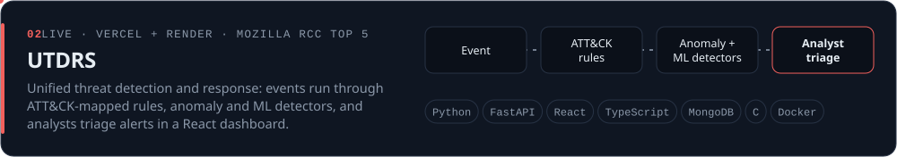
</picture>
</a>

<a href="https://portfolio-alex-m-kamau.vercel.app/work/secure-file-sharing">
<picture>
  <source media="(prefers-color-scheme: dark)" srcset="assets/project-secure-file-sharing-dark.svg" />
  <source media="(prefers-color-scheme: light)" srcset="assets/project-secure-file-sharing-light.svg" />
  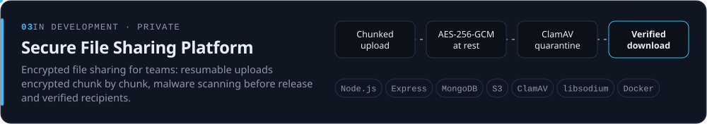
</picture>
</a>

<a href="https://github.com/Alex-Muhscience/MuhOS">
<picture>
  <source media="(prefers-color-scheme: dark)" srcset="assets/project-muhos-dark.svg" />
  <source media="(prefers-color-scheme: light)" srcset="assets/project-muhos-light.svg" />
  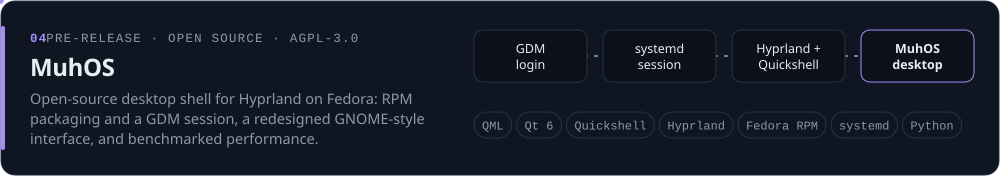
</picture>
</a>

<a href="https://www.euroafriquecorporateskills.com">
<picture>
  <source media="(prefers-color-scheme: dark)" srcset="assets/project-euroafrique-dark.svg" />
  <source media="(prefers-color-scheme: light)" srcset="assets/project-euroafrique-light.svg" />
  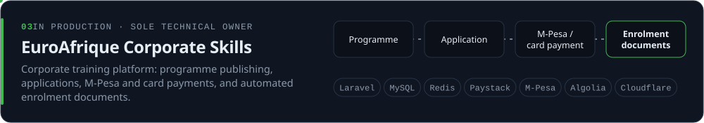
</picture>
</a>

<a href="https://afriasiacareercenter.com">
<picture>
  <source media="(prefers-color-scheme: dark)" srcset="assets/project-afriasia-dark.svg" />
  <source media="(prefers-color-scheme: light)" srcset="assets/project-afriasia-light.svg" />
  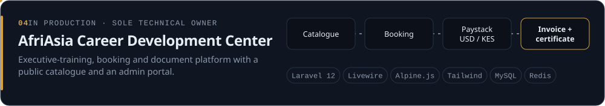
</picture>
</a>

<a href="https://chaniapublishers.com">
<picture>
  <source media="(prefers-color-scheme: dark)" srcset="assets/project-chania-dark.svg" />
  <source media="(prefers-color-scheme: light)" srcset="assets/project-chania-light.svg" />
  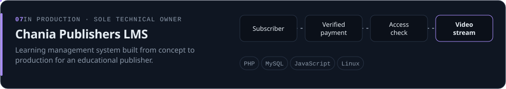
</picture>
</a>

<a href="https://muhscience-tech-labs-website.vercel.app">
<picture>
  <source media="(prefers-color-scheme: dark)" srcset="assets/project-muhscience-dark.svg" />
  <source media="(prefers-color-scheme: light)" srcset="assets/project-muhscience-light.svg" />
  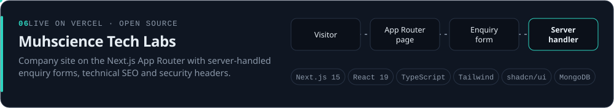
</picture>
</a>

<b>Engineering notes for each project</b>

 

**[BusinessOS](https://portfolio-alex-m-kamau.vercel.app/work/businessos)** — in development, private
- Postgres **row-level security** + app-level authorization
- Transactional **outbox**, signed webhooks, idempotent writes
- JWT with rotating refresh tokens, TOTP 2FA
- CI with Playwright E2E and **k6** load tests

**[UTDRS](https://portfolio-alex-m-kamau.vercel.app/work/unified-threat-detection-response)** — live, private repository, Mozilla RCC Top 5 · [dashboard](https://utdrs-capstone-project.vercel.app)
- Every event runs through MITRE ATT&CK-mapped rules, anomaly and ML detectors
- Analysts triage the alerts in a React dashboard
- Built to keep AI explainable
- Dashboard on **Vercel**, gateway and engine on **Render**, data in MongoDB Atlas

**[Secure File Sharing Platform](https://portfolio-alex-m-kamau.vercel.app/work/secure-file-sharing)** — in development, private
- Per-file keys, every chunk sealed with **AES-256-GCM**
- **Resumable** chunked uploads, streamed range downloads
- Quarantined until **ClamAV** clears it; fails closed
- Workspace roles, email-verified recipients, revocable links

**[MuhOS](https://github.com/Alex-Muhscience/MuhOS)** — open source (AGPL-3.0), pre-release · [case study](https://portfolio-alex-m-kamau.vercel.app/work/muhos) · [releases](https://github.com/Alex-Muhscience/MuhOS/releases)
- Fedora fork of the Serpantinum shell: **RPM packages** and a **GDM session** instead of a `curl | bash` installer
- Redesigned menu bar and control centre in **QML**: GNOME layout, macOS-style glass, Adwaita icons
- Every number measured in a **VM benchmark**: idle shell CPU 0.62% → 0.07% of a core
- Every bundled font, sound and image **licence-checked** in CI

**[EuroAfrique Corporate Skills](https://www.euroafriquecorporateskills.com)** — in production, sole technical owner
- Faster responses via **Redis + Cloudflare** caching
- Manual operations replaced with **automation**
- Enrolment documents generated automatically
- Deploys gated on lint, audits and tests

**[AfriAsia Career Development Center](https://afriasiacareercenter.com)** — in production, sole technical owner
- Paystack in **USD/KES**, idempotent payment recording
- Queued PDF/DOCX invoices, letters and certificates
- Admin **TOTP MFA**, single-session enforcement
- Spatie roles & permissions, audit logs

**[Chania Publishers LMS](https://chaniapublishers.com)** — in production, sole technical owner
- Access granted only on **verified payment**
- Video streamed through an **access-checked** endpoint
- Layered auth / admin / subscriber middleware
- Pages optimised for speed

**[Muhscience Tech Labs](https://muhscience-tech-labs-website.vercel.app)** — live on Vercel, open source · [repository](https://github.com/Alex-Muhscience/Muhscience-Tech-Labs-Website)
- Next.js App Router with server-handled enquiry forms
- Technical SEO and security headers

Also built: <a href="https://github.com/Alex-Muhscience/Pass-KeyGen"><b>KeyGen</b></a> — a Flutter password manager with AES-encrypted storage, PBKDF2 and biometric unlock. Full case studies live on my <a href="https://portfolio-alex-m-kamau.vercel.app/work">portfolio</a>.

## Toolbox

**Languages & frameworks** 

**Data & infrastructure** 

Also: Livewire · Alpine.js · Playwright · k6 · JWT · TOTP MFA · RBAC · Row-level security · M-Pesa · Paystack · Algolia · QML / Qt · Hyprland · RPM packaging · systemd

## Journey

<picture>
  <source media="(prefers-color-scheme: dark)" srcset="assets/journey-dark.svg" />
  <source media="(prefers-color-scheme: light)" srcset="assets/journey-light.svg" />
  
</picture>

## Activity

<picture>
  <source media="(prefers-color-scheme: dark)" srcset="https://raw.githubusercontent.com/Alex-Muhscience/Alex-Muhscience/output/github-streak.svg" />
  <source media="(prefers-color-scheme: light)" srcset="https://raw.githubusercontent.com/Alex-Muhscience/Alex-Muhscience/output/github-streak-light.svg" />
  
</picture>

<picture>
  <source media="(prefers-color-scheme: dark)" srcset="https://raw.githubusercontent.com/Alex-Muhscience/Alex-Muhscience/output/github-contribution-grid-snake-dark.svg" />
  <source media="(prefers-color-scheme: light)" srcset="https://raw.githubusercontent.com/Alex-Muhscience/Alex-Muhscience/output/github-contribution-grid-snake.svg" />
  
</picture>

 

<a href="mailto:alex.kamau.2558@gmail.com">
<picture>
  <source media="(prefers-color-scheme: dark)" srcset="assets/footer-dark.svg" />
  <source media="(prefers-color-scheme: light)" srcset="assets/footer-light.svg" />
  
</picture>
</a>

&nbsp;&nbsp;&nbsp;&nbsp;&nbsp;&nbsp;&nbsp;&nbsp;

 

Every graphic on this page is generated by <a href="scripts/build_assets.py"><code>scripts/build_assets.py</code></a>.

