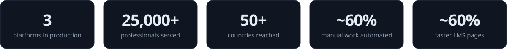

<a href="https://portfolio-alex-m-kamau.vercel.app">
<picture>
  <source media="(prefers-color-scheme: dark)" srcset="assets/hero-dark.svg" />
  <source media="(prefers-color-scheme: light)" srcset="assets/hero-light.svg" />
  
</picture>
</a>

  

[**Portfolio**](https://portfolio-alex-m-kamau.vercel.app) &nbsp;·&nbsp; [**Case studies**](https://portfolio-alex-m-kamau.vercel.app/work) &nbsp;·&nbsp; [**Résumé**](https://flowcv.com/resume/t249m8own6) &nbsp;·&nbsp; [**LinkedIn**](https://www.linkedin.com/in/alex-m-kamau-20015b340) &nbsp;·&nbsp; [**Email**](mailto:alex.kamau.2558@gmail.com)

 

I design, build and **operate** business-critical web platforms — from the first requirements conversation to the production server, and everything after it ships.

Today I'm the full-stack developer and sole technical owner for three companies: **EuroAfrique Corporate Skills**, **Chania Publishers** and **AfriAsia Career Development Center**. Each runs on a platform I architected, built, deployed and keep running. On the side, I'm building **BusinessOS**, a multi-tenant business operating system on Laravel, Next.js and PostgreSQL. I was a **Top 5 finalist** in the Mozilla Responsible Computing Challenge.

 

<picture>
  <source media="(prefers-color-scheme: dark)" srcset="assets/metrics-dark.svg" />
  <source media="(prefers-color-scheme: light)" srcset="assets/metrics-light.svg" />
  
</picture>

## How I put a platform together

Not one system, but the shape most of mine share: a boring, fast request path, with everything slow or failure-prone pushed behind it.

<picture>
  <source media="(prefers-color-scheme: dark)" srcset="assets/architecture-dark.svg" />
  <source media="(prefers-color-scheme: light)" srcset="assets/architecture-light.svg" />
  
</picture>

- **Architecture follows requirements.** A content site, a payment workflow and a multi-tenant ledger don't want the same design.
- **Modular monolith first.** Services get extracted when a domain proves it needs to scale or release on its own.
- **Contain failure.** A slow PDF render or a dead webhook should never fail an unrelated checkout.
- **Security and audit are architecture,** designed in from the first schema — not bolted on later.
- **Measure, then optimise.** Find the bottleneck with real data volume, then fix that one thing.
- **Build systems that can be operated.** Health checks, correlated logs, repeatable deploys and tested restores are part of the feature.

## Featured work

<table>
<tr>
<td width="50%" valign="top">

#### [BusinessOS](https://portfolio-alex-m-kamau.vercel.app/work/businessos)
`In development` · `Private`

Multi-tenant operating system for SMEs — CRM, sales, procurement, inventory, finance, HR and projects on one governed data model.

- Postgres **row-level security** + app-level authorization
- Transactional **outbox**, signed webhooks, idempotent writes
- JWT with rotating refresh tokens, TOTP 2FA
- CI with Playwright E2E and **k6** load tests

Laravel 13 · Next.js 16 · PostgreSQL 18 · Redis · Docker · nginx

</td>
<td width="50%" valign="top">

#### [EuroAfrique Corporate Skills](https://www.euroafriquecorporateskills.com)
`In production` · `Sole technical owner`

Corporate training platform: programme publishing, applications, M-Pesa and card payments, and automated enrolment documents.

- **25,000+** alumni across **50+** countries
- **~35%** lower latency via Redis + Cloudflare
- **~60%** less manual ops through automation
- Deploys gated on lint, audits and tests

Laravel · MySQL · Redis · Paystack · M-Pesa · Algolia · Cloudflare

</td>
</tr>
<tr>
<td width="50%" valign="top">

#### [Chania Publishers LMS](https://chaniapublishers.com)
`In production` · `Sole technical owner`

Learning management system built from concept to production for an educational publisher.

- Access granted only on **verified payment**
- Video streamed through an **access-checked** endpoint
- Layered auth / admin / subscriber middleware
- **~60%** faster pages after optimisation

PHP · MySQL · JavaScript · Linux

</td>
<td width="50%" valign="top">

#### [AfriAsia Career Development Center](https://afriasiacareercenter.com)
`In production` · `Sole technical owner`

Executive-training, booking and document platform with a public catalogue and an admin portal.

- Paystack in **USD/KES**, idempotent payment recording
- Queued PDF/DOCX invoices, letters and certificates
- Admin **TOTP MFA**, single-session enforcement
- Spatie roles & permissions, audit logs

Laravel 12 · Livewire · Alpine.js · Tailwind · MySQL · Redis

</td>
</tr>
<tr>
<td width="50%" valign="top">

#### [UTDRS — Threat Detection & Response](https://portfolio-alex-m-kamau.vercel.app/work/unified-threat-detection-response)
`Mozilla RCC Top 5` · `In development` · `Private`

Every event runs through MITRE ATT&CK-mapped rules, anomaly and ML detectors, and analysts triage the alerts in a React dashboard — built to keep AI explainable.

[Case study](https://portfolio-alex-m-kamau.vercel.app/work/unified-threat-detection-response)

Python · FastAPI · React · TypeScript · MongoDB · C · Docker

</td>
<td width="50%" valign="top">

#### [Muhscience Tech Labs](https://muhscience-tech-labs-website.vercel.app)
`Live on Vercel` · `Open source`

Company site on the Next.js App Router with server-handled enquiry forms, technical SEO and security headers.

[Live site](https://muhscience-tech-labs-website.vercel.app) · [Repository](https://github.com/Alex-Muhscience/Muhscience-Tech-Labs-Website)

Next.js 15 · React 19 · TypeScript · Tailwind · shadcn/ui · MongoDB

</td>
</tr>
</table>

Also built: <a href="https://github.com/Alex-Muhscience/Pass-KeyGen"><b>KeyGen</b></a> — a Flutter password manager with AES-encrypted storage, PBKDF2 and biometric unlock. Full case studies live on my <a href="https://portfolio-alex-m-kamau.vercel.app/work">portfolio</a>.

## Toolbox

| Layer | What I reach for |
|---|---|
| **Backend** | PHP · Laravel · Livewire · Python · FastAPI · Flask · Node.js |
| **Frontend** | TypeScript · React · Next.js · Tailwind · Alpine.js |
| **Mobile** | Dart · Flutter |
| **Data** | PostgreSQL · MySQL · Redis · MongoDB · SQLite · Algolia |
| **Infrastructure** | Linux · Docker · nginx · Cloudflare · Vercel · GitHub Actions |
| **Quality & security** | Playwright · k6 · JWT · TOTP MFA · RBAC · row-level security |
| **Payments** | M-Pesa · Paystack |

## Journey

| When | Role | Where |
|---|---|---|
| **Aug 2025 → now** | Full-Stack Developer & Technical Owner | EuroAfrique Corporate Skills · Chania Publishers · AfriAsia Career Development Center |
| May – Aug 2025 | Freelance Web Development Tutor | Self-employed |
| Aug 2024 – Feb 2025 | Network Technician | Gicatech Enterprise Solutions |
| May – Aug 2024 | Software Development Intern | Secunets Technologies |
| 2021 – 2025 | BSc Computer Science, Second Class Honours (Upper) | Kisii University |

## Activity

<picture>
  <source media="(prefers-color-scheme: dark)" srcset="https://raw.githubusercontent.com/Alex-Muhscience/Alex-Muhscience/output/github-streak.svg" />
  <source media="(prefers-color-scheme: light)" srcset="https://raw.githubusercontent.com/Alex-Muhscience/Alex-Muhscience/output/github-streak-light.svg" />
  
</picture>

<picture>
  <source media="(prefers-color-scheme: dark)" srcset="https://raw.githubusercontent.com/Alex-Muhscience/Alex-Muhscience/output/github-contribution-grid-snake-dark.svg" />
  <source media="(prefers-color-scheme: light)" srcset="https://raw.githubusercontent.com/Alex-Muhscience/Alex-Muhscience/output/github-contribution-grid-snake.svg" />
  
</picture>

---

### Let's build something that lasts

Open to **full-stack and backend engineering roles**, technical partnerships and product work where reliability matters.

[**portfolio-alex-m-kamau.vercel.app**](https://portfolio-alex-m-kamau.vercel.app) &nbsp;·&nbsp; [**LinkedIn**](https://www.linkedin.com/in/alex-m-kamau-20015b340) &nbsp;·&nbsp; [**alex.kamau.2558@gmail.com**](mailto:alex.kamau.2558@gmail.com)

The header, metrics and diagram on this page are generated by <a href="scripts/build_assets.py"><code>scripts/build_assets.py</code></a> — no third-party widgets.

