

<a href="https://portfolio-alex-m-kamau.vercel.app">
<picture>
  <source media="(prefers-color-scheme: dark)" srcset="assets/hero-dark.svg" />
  <source media="(prefers-color-scheme: light)" srcset="assets/hero-light.svg" />
  
</picture>
</a>

&nbsp;&nbsp;&nbsp;&nbsp;&nbsp;&nbsp;&nbsp;&nbsp;

 

I'm a full-stack engineer who designs, builds and **runs** the platforms businesses depend on, from the first requirements conversation to the Linux server and every release after it.

Today I'm the sole technical owner of four companies' platforms, and I build my own products and open-source software alongside. My bias is towards systems that are calm to operate: clear data models, payments that can't double-charge, security designed into the first schema, and performance measured before it's optimised.

## Platforms I run for businesses

<a href="https://www.euroafriquecorporateskills.com"><picture><source media="(prefers-color-scheme: dark)" srcset="assets/card-euroafrique-dark.svg" /><source media="(prefers-color-scheme: light)" srcset="assets/card-euroafrique-light.svg" /></picture></a>&nbsp;<a href="https://afriasiacareercenter.com"><picture><source media="(prefers-color-scheme: dark)" srcset="assets/card-afriasia-dark.svg" /><source media="(prefers-color-scheme: light)" srcset="assets/card-afriasia-light.svg" />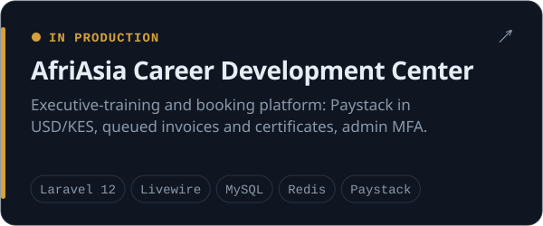</picture></a>

<a href="https://chaniapublishers.com"><picture><source media="(prefers-color-scheme: dark)" srcset="assets/card-chania-dark.svg" /><source media="(prefers-color-scheme: light)" srcset="assets/card-chania-light.svg" /></picture></a>&nbsp;<a href="https://portfolio-alex-m-kamau.vercel.app/work/chania-finance-consultancy"><picture><source media="(prefers-color-scheme: dark)" srcset="assets/card-chania-finance-dark.svg" /><source media="(prefers-color-scheme: light)" srcset="assets/card-chania-finance-light.svg" />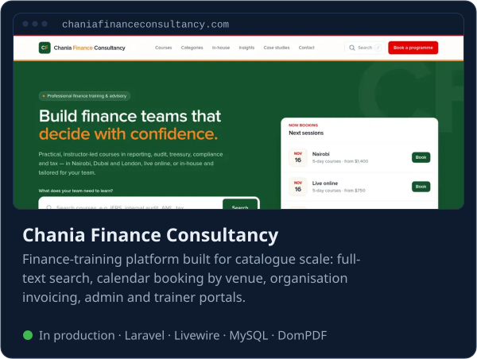</picture></a>

## Products and open source

<a href="https://portfolio-alex-m-kamau.vercel.app/work/businessos"><picture><source media="(prefers-color-scheme: dark)" srcset="assets/card-businessos-dark.svg" /><source media="(prefers-color-scheme: light)" srcset="assets/card-businessos-light.svg" />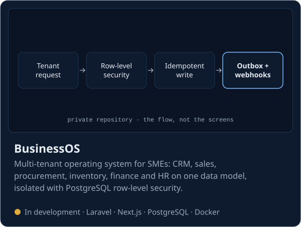</picture></a>&nbsp;<a href="https://portfolio-alex-m-kamau.vercel.app/work/unified-threat-detection-response"><picture><source media="(prefers-color-scheme: dark)" srcset="assets/card-utdrs-dark.svg" /><source media="(prefers-color-scheme: light)" srcset="assets/card-utdrs-light.svg" />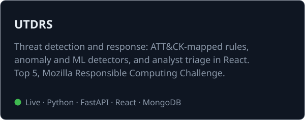</picture></a>

<a href="https://portfolio-alex-m-kamau.vercel.app/work/secure-file-sharing"><picture><source media="(prefers-color-scheme: dark)" srcset="assets/card-secure-file-sharing-dark.svg" /><source media="(prefers-color-scheme: light)" srcset="assets/card-secure-file-sharing-light.svg" />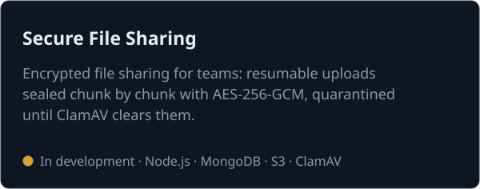</picture></a>&nbsp;<a href="https://github.com/Alex-Muhscience/MuhOS"><picture><source media="(prefers-color-scheme: dark)" srcset="assets/card-muhos-dark.svg" /><source media="(prefers-color-scheme: light)" srcset="assets/card-muhos-light.svg" />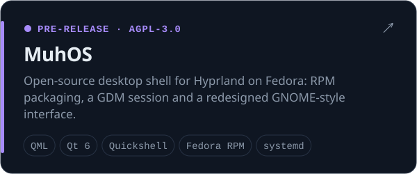</picture></a>

Also built: <a href="https://muhscience-tech-labs-website.vercel.app"><b>Muhscience Tech Labs</b></a>, a Next.js company site, and <a href="https://github.com/Alex-Muhscience/Pass-KeyGen"><b>KeyGen</b></a>, a Flutter password manager. Every project has a full case study on my <a href="https://portfolio-alex-m-kamau.vercel.app/work">portfolio</a>.

## How I work

<picture>
  <source media="(prefers-color-scheme: dark)" srcset="assets/principles-dark.svg" />
  <source media="(prefers-color-scheme: light)" srcset="assets/principles-light.svg" />
  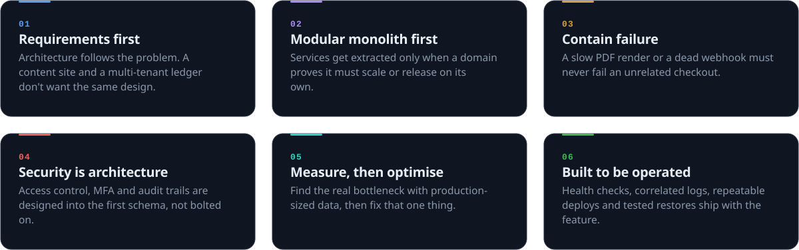
</picture>

<b>The shape most of my platforms share</b>

 

A boring, fast request path, with everything slow or failure-prone pushed behind it.

<picture>
  <source media="(prefers-color-scheme: dark)" srcset="assets/architecture-dark.svg" />
  <source media="(prefers-color-scheme: light)" srcset="assets/architecture-light.svg" />
  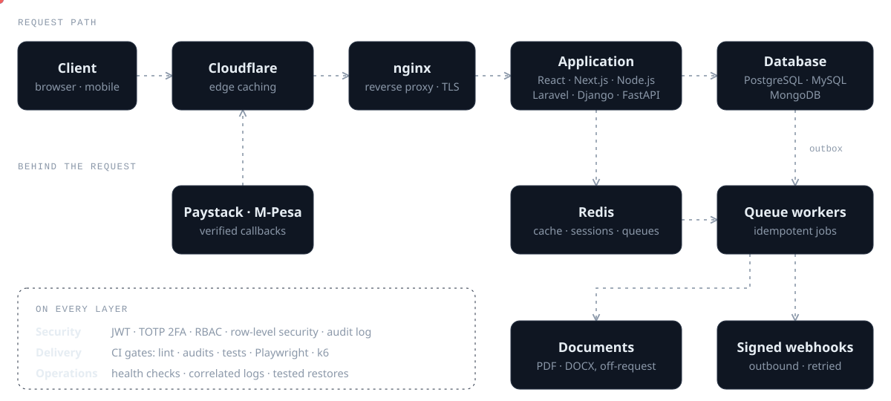
</picture>

## Stack

<picture>
  <source media="(prefers-color-scheme: dark)" srcset="assets/stack-dark.svg" />
  <source media="(prefers-color-scheme: light)" srcset="assets/stack-light.svg" />
  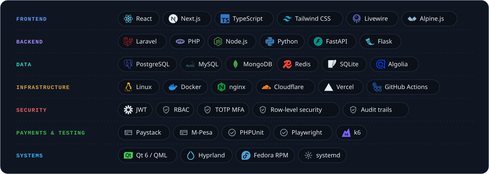
</picture>

## Journey

<picture>
  <source media="(prefers-color-scheme: dark)" srcset="assets/journey-dark.svg" />
  <source media="(prefers-color-scheme: light)" srcset="assets/journey-light.svg" />
  
</picture>

## Activity

<picture>
  <source media="(prefers-color-scheme: dark)" srcset="https://raw.githubusercontent.com/Alex-Muhscience/Alex-Muhscience/output/github-contribution-grid-snake-dark.svg" />
  <source media="(prefers-color-scheme: light)" srcset="https://raw.githubusercontent.com/Alex-Muhscience/Alex-Muhscience/output/github-contribution-grid-snake.svg" />
  
</picture>

 

<a href="mailto:alex.kamau.2558@gmail.com">
<picture>
  <source media="(prefers-color-scheme: dark)" srcset="assets/footer-dark.svg" />
  <source media="(prefers-color-scheme: light)" srcset="assets/footer-light.svg" />
  
</picture>
</a>

Every graphic on this page is generated by <a href="scripts/build_assets.py"><code>scripts/build_assets.py</code></a>. Logos from <a href="https://simpleicons.org">Simple Icons</a>.

